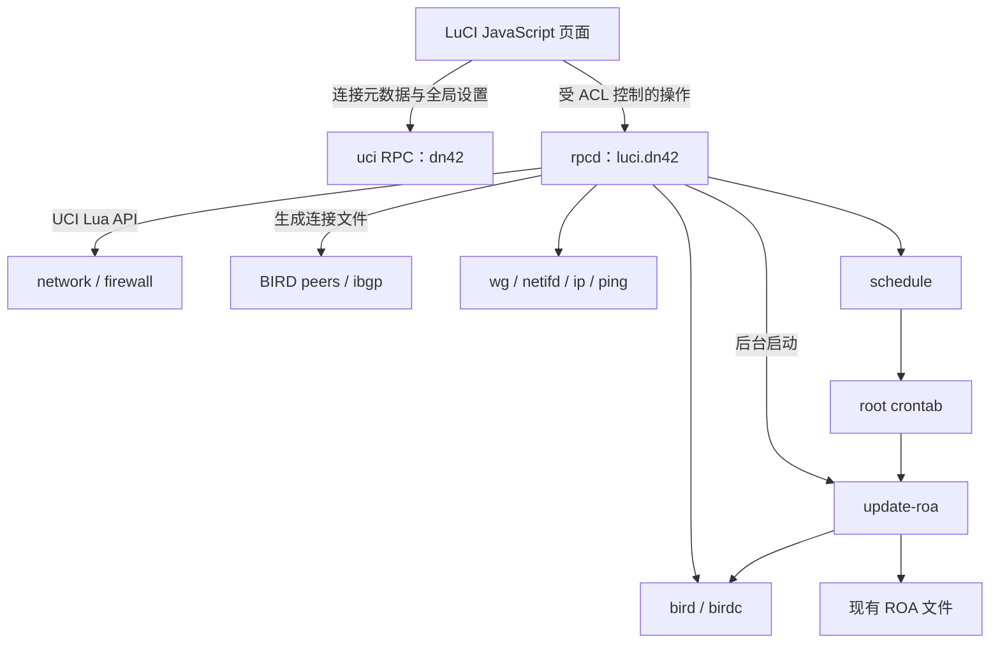
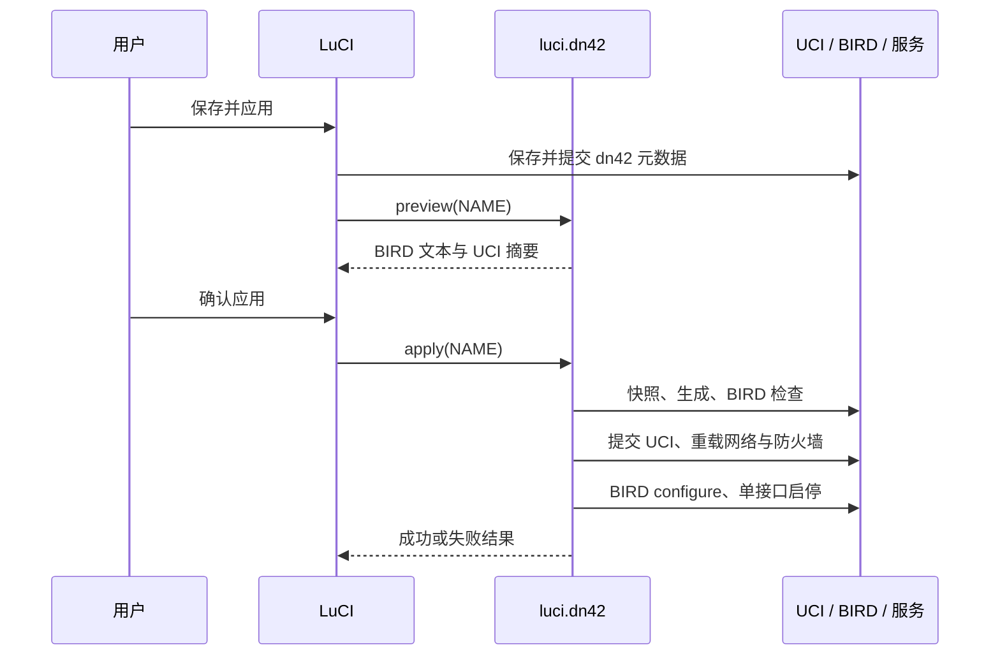

# luci-app-dn42 项目设计与实现说明

文档日期：2026-10-14。本文描述当前仓库源码，并明确标出尚未实现或尚未验证的部分。代码与本文发生差异时，以源码行为为准。

## 1. 项目定位与当前阶段

`luci-app-dn42` 是面向 OpenWrt / ImmortalWrt 的 LuCI 管理插件，连接现有 WireGuard、BIRD 2、UCI 和防火墙配置，为 DN42 提供连接管理、状态查看和 ROA 更新入口。

项目目前处于**首版源码、待 SDK 构建与实机联调**阶段。已进行本地语法检查和 11 项隔离测试；未完成 OpenWrt 安装、真实 rpcd 调用、LuCI 浏览器交互、真实 BIRD 解析及隧道连通性验收。不能把模拟测试通过理解为已经可以在生产设备直接部署。

### 1.1 已确认的需求

- 根据远端 ASN 和连接名称识别、展示多个 peer。
- 输入远端 ASN、公钥、WireGuard Endpoint、可选本地监听端口、Keepalive、LLA、区域和 transit 选项，生成 WireGuard 与 BGP 配置。
- WireGuard 和防火墙使用 UCI 管理。
- 沿用现有 `/etc/bird/peers/`、`/etc/bird/ibgp/` 结构及 transit / 非 transit 模板。
- 支持 IPv4、IPv6 和基于 IPv6 LLA 的 BGP 会话与下一跳。
- 查看 BGP 概况、会话详情和对应 WireGuard 状态。
- 提供 ROA 手动更新与自动更新，保留既有 ROA 文件名。

### 1.2 管理边界

插件负责创建和维护有明确归属标识的新连接，不把整个设备的网络配置接管进来。LAN、DHCP、IPv6 PD、SNAT、自有聚合路由、kernel/direct 协议和既有外部路由策略由原配置负责。

已存在的手工 BGP 协议可在总览中看到，但尚不能自动导入为可编辑连接。插件当前不会自动生成全局 ASN、Router ID、ROA 表或自有前缀定义。

## 2. 功能实现状态

| 功能 | 当前实现 | 边界 |
|---|---|---|
| ASN 与名称 | 连接元数据、状态页按 ASN 分组、名称显示 | 尚无独立 AS 对象、节点对象或搜索筛选器 |
| WireGuard 创建 | UCI 接口、peer、地址、端口、密钥、MTU、AllowedIPs | 每条连接一个接口；接口名需手动填写 |
| BGP 创建 | 独立文件、eBGP 模板引用、iBGP 过滤器 | 主配置和模板须预先存在 |
| transit | 选择已有模板名称 | 不检查两个模板的策略是否真的不同 |
| 双栈与 LLA | LLA 会话、IPv4 扩展下一跳、IPv6 channel | 模板继承行为和目标版本兼容性尚待实测 |
| iBGP / RR | 同 AS 会话、可选 `rr client` | 不自动创建多节点拓扑、cluster ID 或全网前缀清单 |
| 配置预览 | 展示 BIRD 文本、接口和区域摘要 | 不是完整 UCI / 防火墙差异比较 |
| 应用与删除 | 本地快照、失败恢复 | 不是跨服务原子事务；恢复操作结果未逐项确认 |
| BGP 概况与详情 | `birdc` 原始输出 | 尚无结构化状态计数、告警或历史图表 |
| WG 详情 | `wg show` 原始输出 | 仅关联插件配置的连接 |
| BGP 操作 | 运行时启用、停用、导入重载 | 启停不修改持久配置 |
| 路由查询 | 按前缀查询 `show route for … all` | 是覆盖该目标的路由查询，不是全表分页或精确前缀列表 |
| 诊断 | 接口 IPv6 地址与指定接口的 LLA ping | 尚无 DNS、外层 Endpoint 路由和端到端检查 |
| ROA 更新 | 双栈下载、校验、恢复、结果记录 | 固定文件路径和表名，没有条目统计或历史版本管理 |
| 定时更新 | 每小时指定分钟 | 不支持任意周期或原有任务自动迁移 |

## 3. 架构



前端只通过 UCI RPC 编辑 `dn42` 包，通过受限业务 RPC 请求后端操作。前端没有直接写入 `network` 或 `firewall` 的 ACL 权限；后端由 rpcd 执行，承担配置生成、输入检查、服务操作和恢复职责。

### 3.1 技术组件

| 组件 | 职责 |
|---|---|
| LuCI `view`、`form`、`uci`、`rpc`、`poll`、`dom` | 页面、表单、元数据保存、RPC 和轮询 |
| Lua、`luci.jsonc`、`uci` | JSON RPC 输入输出、UCI 配置访问 |
| POSIX shell | ROA 更新和 crontab 管理 |
| BIRD 2 的 `bird`、`birdc` | 静态配置检查、运行时配置和状态 |
| `wireguard-tools` | 密钥生成、运行状态 |
| netifd / `ubus` / `ifup` / `ifdown` | 应用和启停网络接口 |
| fw4 对应的 firewall init 服务 | 重载防火墙 |
| curl / cron / logger | 下载、调度、系统日志 |

Makefile 声明 `luci-base`、`luci-lib-jsonc`、`lua`、`libuci-lua`、`curl` 和 `wireguard-tools`。BIRD 2 及 WireGuard 内核支持需要设备预先安装；当前不自动选择或替换设备已有的 BIRD 包。

### 3.2 源码布局

| 路径 | 内容 |
|---|---|
| `Makefile` | LuCI 包构建声明，目标架构为 `all` |
| `root/etc/config/dn42` | 全局默认值 |
| `root/usr/share/luci/menu.d/luci-app-dn42.json` | 网络 → DN42 菜单 |
| `root/usr/share/rpcd/acl.d/luci-app-dn42.json` | UCI 和业务 RPC 权限 |
| `root/usr/libexec/rpcd/luci.dn42` | RPC 入口、生成器、状态和连接生命周期 |
| `root/usr/libexec/dn42/update-roa` | ROA 更新入口 |
| `root/usr/libexec/dn42/schedule` | 插件定时任务管理 |
| `htdocs/luci-static/resources/view/dn42/peers.js` | 连接表单、预览、应用与删除 |
| `htdocs/luci-static/resources/view/dn42/status.js` | 状态、路由查询与运行时操作 |
| `htdocs/luci-static/resources/view/dn42/roa.js` | 全局模板与 ROA 设置 |
| `tests/test_backend.py` | 命令执行、标识符与 shell 转义测试 |
| `tests/test_generation.py` | 三类 BGP 预览生成测试 |
| `tests/test_roa.py` | ROA 更新流程测试 |

## 4. 数据模型

### 4.1 全局设置：`config global 'settings'`

| 字段 | 默认值 | 含义 |
|---|---|---|
| `bird_conf` | `/etc/bird.conf` | 主配置路径；当前后端只接受此路径 |
| `normal_template` | `dnpeers` | 非 transit eBGP 模板 |
| `transit_template` | `dnpeers_transit` | transit eBGP 模板 |
| `roa4_url` | burble IPv4 BIRD 2 ROA 地址 | IPv4 下载源 |
| `roa6_url` | burble IPv6 BIRD 2 ROA 地址 | IPv6 下载源 |
| `roa_auto` | `0` | 自动更新开关 |
| `roa_minute` | `17` | 每小时第几分钟执行，0–59 |

下载源初始值见 `root/etc/config/dn42`。下载使用 HTTPS，但尚未验证每次重定向的协议和目标，也未限制响应大小；管理员修改来源时需要信任该来源提供的 BIRD 配置片段。

### 4.2 连接设置：`config peer 'NAME'`

`NAME` 是连接主键，与 ASN、显示名称分离。后端要求 NAME 和接口名以英文字母开头、仅包含字母数字下划线、最多 15 字符。当前界面不会自动根据 ASN 分配接口名。

| 字段 | 类型 / 默认 | 含义 |
|---|---|---|
| `enabled` | 开关，`1` | 持久启用状态，影响接口 auto 和生成的 BGP disabled |
| `asn` | 整数 | 远端 ASN，1–4294967295 |
| `label` | 文本 | 对方 / 节点显示名称 |
| `kind` | `ebgp` / `ibgp` | 会话类别 |
| `iface` | 标识符 | 独立 WireGuard 接口名 |
| `public_key` | Base64 文本 | 远端公钥 |
| `private_key` | 可选、密码框 | 本地私钥；未填写时复用接口旧密钥或运行 `wg genkey` |
| `preshared_key` | 可选、密码框 | PSK |
| `endpoint` | 可选 | 远端域名或 IP；留空为等待对端发起 |
| `endpoint_port` | 可选端口 | 填写 Endpoint 时必填 |
| `listen_port` | 可选端口 | 未填写时交由 WireGuard 自动选择 |
| `keepalive` | `25` | NAT 保活秒数，0 为关闭 |
| `local_lla` / `remote_lla` | `fe80::1` / `fe80::2` | 会话地址，不包含掩码或接口后缀 |
| `addresses` | 地址列表 | 除本地 LLA /64 之外的本地接口地址 |
| `allowed_ips` | 前缀列表 | 留空使用默认互联网段，再加入对端 LLA /128 |
| `mtu` | `1420` | 接口 MTU，界面范围 1280–9000 |
| `zone` | 现有区域名称 | 隧道内的防火墙区域 |
| `listen_zone` | 可选区域 | 外层 UDP 入站区域，通常是 WAN 区域 |
| `ipv4` / `ipv6` | 开关，均为 `1` | 路由地址族；至少选一个 |
| `transit` | 开关，`0` | eBGP 使用哪一个已有模板 |
| `rr_client` | 开关，`0` | iBGP 对端是否作为本机的 RR 客户端 |
| `internal4` / `internal6` | 前缀列表 | 本机与内部对端允许交换的内部前缀 |

本地监听端口和 Keepalive 独立：前者确定外层 UDP 监听端口，后者维持 NAT 映射。未指定本地端口时，不为随机端口自动新增 WAN 放行规则。

### 4.3 归属标识与名称映射

| 资源 | 名称 / 标识 |
|---|---|
| WireGuard 接口 | 用户填写的 `iface`；`dn42_owner=NAME` |
| WireGuard peer | `dn42p_NAME` |
| BIRD 协议 | `dn42_NAME` |
| BIRD 文件 | `peers/dn42_NAME.conf` 或 `ibgp/dn42_NAME.conf` |
| BIRD 文件标记 | `# managed by luci-app-dn42` |
| BGP 放行规则 | `dn42bgp_NAME`；`dn42_owner=NAME` |
| ICMPv6 放行规则 | `dn42icmp_NAME`；`dn42_owner=NAME` |
| 外层 UDP 放行规则 | `dn42udp_NAME`；`dn42_owner=NAME` |

现有同名接口、规则或 BIRD 文件不属于插件时，应用应拒绝覆盖。WireGuard peer section 自身尚未单独做归属校验，需要在后续补齐同名冲突保护。

## 5. WireGuard 与防火墙生成

### 5.1 独立隧道

每条连接创建一个 `proto=wireguard` 的 UCI interface 和一个 `wireguard_IFACE` 类型的 peer。独立接口允许不同连接重复使用相同 LLA，并通过接口作用域区分下一跳。

接口地址至少包含 `local_lla/64`。插件不会默认把 `OWNIP`、`OWNIPv6` 自动加到每条隧道；需要的额外地址由 `addresses` 指定。

所有 WG 配置更改使用 UCI Lua API。正常生成流程不直接拼接 `/etc/config/network`；失败恢复时会把应用前的完整配置文本写回，这是恢复机制的一部分。

### 5.2 AllowedIPs 与路由

默认 AllowedIPs：

```text
172.20.0.0/14
172.31.0.0/16
10.0.0.0/8
fd00::/8
REMOTE_LLA/128
```

自定义非空 AllowedIPs 替代上述四个默认网段，后端仍追加对端 LLA /128。去重尚未实现。

生成的 peer 固定 `route_allowed_ips=0`，避免把 DN42 大网段直接指向某个 peer。实际路由由既有 BIRD kernel/direct 配置及系统直连路由决定。

需要互通 `192.168` LAN 时，既要允许 BGP 交换对应内部前缀，也要在双方 AllowedIPs 中允许这些地址，并已有相应防火墙转发关系。插件当前不会自动把 `internal4/internal6` 合并到 AllowedIPs，也不会自动创建 LAN 与隧道之间的 forwarding。

### 5.3 防火墙

应用会将接口移出其他区域的 network 列表，再加入选定的 `zone`；不会更改该区域的 input/output/forward 全局策略。

自动创建的规则为：

- 隧道区域内，从对端 LLA 到本机 TCP 179 的 IPv6 BGP 放行。
- 隧道区域内，从对端 LLA 到本机的 ICMPv6 放行。
- 同时填写 `listen_port` 和 `listen_zone` 时，为该外层区域开放对应 UDP 端口。

这些规则主要保障 BGP 与 LLA 诊断，不等于数据转发已经获准。选择区域时需要结合已有转发和 SNAT 策略。

## 6. BIRD 配置设计

### 6.1 既有配置前提

主配置必须已有相应目录的 include，推荐：

```bird
include "/etc/bird/ibgp/*.conf";
include "/etc/bird/peers/*.conf";
```

当前代码用主配置文本是否含目录字符串做前置检查，不是真正的 include 语义分析。完整语法验证由 `bird -p -c /etc/bird.conf` 完成。模板不存在等错误会在实际应用时由 BIRD 检查发现；预览本身不进行完整 BIRD 检查。

### 6.2 eBGP 与 transit

eBGP 使用：

```bird
protocol bgp dn42_NAME from EXISTING_TEMPLATE {
    neighbor REMOTE_LLA%IFACE as REMOTE_AS;
    interface "IFACE";
    source address LOCAL_LLA;
    direct;
    # 根据连接设置补充地址族与下一跳选项
}
```

`transit=0` 选择 `normal_template`，`transit=1` 选择 `transit_template`。插件不重新定义导入、导出策略，也不保证非 transit 模板一定只发布自有前缀；实际政策完全由已有模板决定。

开启的 IPv4 channel 加入 `extended next hop on`、`require extended next hop on`、`next hop self` 和本地 LLA 下一跳；IPv6 channel 加入后两项。关闭的 eBGP 地址族生成 `import none; export none;`，这只明确禁止交换路由，**不能表述成必然撤销该地址族能力协商**。

### 6.3 iBGP 与内部前缀

iBGP 不继承 eBGP 模板，生成 `local as OWNAS`，并依赖主配置已有以下符号：

```text
OWNAS
is_valid_network()
is_valid_network_v6()
dn42_roa
dn42_roa_v6
```

导入逻辑：内部前缀列表匹配且 AS_PATH 为空时接受；其他有效网络须具有非空 AS_PATH 并通过对应 ROA 表验证；否则拒绝。

导出逻辑：内部前缀列表匹配且来源为 DEVICE、STATIC 或 BGP 时接受；有效网络且来源为 BGP 时接受；否则拒绝。

因此，来自 STATIC 的自有聚合前缀必须包含在内部允许列表内，才能由该节点发布给内部对端。多个节点的列表需要管理员维护，当前不会根据注册对象或邻居关系自动推导。

`rr_client=1` 使本机将该对端视为 RR 客户端，不代表对端自身成为 RR。RR cluster ID、冗余 RR 和环路验证尚未形成全局配置模型。

## 7. 连接生命周期

### 7.1 保存、预览与应用



取消预览仅取消资源应用，先前提交的 `dn42` 元数据仍保留。因此，“表单保存”和“连接资源已经应用”是不同状态；当前未建立独立的 applied revision 字段。

应用检查包括 ASN、标识符、公钥格式、端口、LLA、已有区域、接口归属、插件内端口/接口重复和已应用连接的接口名、类型变更。网络或防火墙存在 CLI 可见的未提交修改时拒绝应用；此检查不能覆盖其他 LuCI 会话中的全部暂存修改。

应用前读取旧 BIRD 文件和完整 network/firewall 文件；写入生成文件后先执行 BIRD 检查，再提交 UCI、调用 network reload、重载防火墙、重配置 BIRD，并对目标接口 ifup/ifdown。

### 7.2 失败恢复

应用失败时恢复旧配置文本与 BIRD 文件，执行 UCI revert、网络/防火墙重载和 BIRD configure。`dn42` 元数据不随资源恢复回滚，方便用户修改后重试。

这是尽力恢复机制：没有磁盘持久事务日志，不保证进程被强制终止或设备掉电后的恢复；恢复命令输出也未逐项核验。服务重载可能影响其他接口，当前不是仅针对目标接口的完全隔离事务。

BIRD 返回 `Reconfiguration in progress` 会被视为请求已接受，不等待异步重配置最终完成。对端未握手或 BGP 未建立不会触发回滚。

### 7.3 删除

删除草稿时不操作网络。删除已应用连接时检查接口归属、快照配置和生成文件、ifdown、移除 UCI section/区域关联/规则、删除 BIRD 文件，再重配置服务。失败时尝试恢复资源。

资源删除成功后，前端才删除并提交 `dn42` 元数据。若该步骤失败，可能残留元数据，需要刷新并检查。缺少合法接口名的未完成草稿可能无法通过当前后端删除校验，这是需修复的交互边界。

### 7.4 并发

配置类 RPC 使用目录锁 `/var/lock/dn42-luci`。只读状态、详情、预览、查询和诊断不占此锁。

ROA 使用另一个目录锁 `/var/lock/dn42-roa-update`。两类锁相互独立，因此后台 ROA 与连接应用仍可能同时操作 BIRD 和配置文件；后续应增加共同的 BIRD 写入锁。强制终止进程可能遗留锁目录，目前无自动过期判断。

## 8. 状态、操作与 RPC

### 8.1 页面行为

状态页每 10 秒调用 `status`，显示所有 BIRD 协议的原始列表，以及插件元数据中的连接按 ASN 分组后的 WG 信息。名称作为连接标题显示，尚未提供按名称独立分组。

详情调用 `birdc show protocols all dn42_NAME` 和 `wg show IFACE`。不会仅凭最近握手时间宣称 WireGuard 在线或离线。

BGP enable/disable 只修改当前 BIRD 运行状态，下次重配置可恢复生成文件中的持久 `enabled` 状态。导入重载会重新处理指定协议；未运行的会话可能返回错误。

### 8.2 RPC 列表

对象：`luci.dn42`。参数与返回值均为 JSON。

| 方法 | 参数 | 主要返回 | 主要行为 |
|---|---|---|---|
| `status` | 无 | `protocols`, `peers`, `roa`, `roa_log` | 总览、WG 和 ROA 结果 |
| `detail` | `name` | `bgp`, `wg` | 单连接原始详情 |
| `preview` | `name` | `ok`, `message` | 生成预览，不写资源 |
| `apply` | `name` | `ok`, `message` | 创建或更新连接 |
| `remove` | `name` | `ok`, `message` | 删除连接资源，不删除元数据 |
| `action` | `name`, `operation` | `ok`, `message` | `enable` / `disable` / `reload` |
| `route` | `prefix` | `ok`, `message` | BIRD 覆盖目标路由查询 |
| `diagnose` | `name` | `ok`, `message` | IPv6 地址、LLA ping |
| `roa` | 无 | `ok`, `message` | 后台启动更新，不等待完成 |
| `schedule` | 无 | `ok`, `message` | 更新插件 cron 条目 |

失败通常返回 `{ "ok": false, "message": "原因" }`。当前 `status/detail` 不统一携带 `ok`，`diagnose` 的 `ok=true` 也不代表 ping 成功；诊断结论需要查看输出。这是未来结构化 API 应统一的部分。

CLI 调用示例：

```sh
ubus call luci.dn42 status '{}'
ubus call luci.dn42 preview '{"name":"peer1"}'
ubus call luci.dn42 detail '{"name":"peer1"}'
ubus call luci.dn42 route '{"prefix":"172.20.0.0/24"}'
```

`peer1` 仅为占位连接名，需替换为实际 UCI section 名称。上述示例属于只读查询和预览。

## 9. ROA 更新机制

### 9.1 与原目录共存

保持原文件：

```text
/etc/bird/dn42_roa.conf
/etc/bird/dn42_roa_v6.conf
/etc/bird/update-roa.sh
```

插件更新入口是 `/usr/libexec/dn42/update-roa`。既有 `update-roa.sh` 不修改、不调用；两者必须避免被不同定时任务重复执行。旧脚本不受插件锁控制。

### 9.2 更新流程

1. 获取 ROA 目录锁，创建 `/tmp` 临时目录。
2. 从 UCI 读取 HTTPS 来源，分别下载 IPv4 和 IPv6 文件；连接超时 15 秒，单文件总超时 60 秒。
3. 检查非空，并用临时 ROA 表配置执行 `bird -p`。
4. 与现有两文件比较；均未变化时记录 `unchanged` 后结束。
5. 将旧文件备份到临时目录，替换现有文件。
6. 对真实主配置执行 `bird -p`，再运行 `birdc configure`。
7. 检查重配置输出；失败恢复旧文件并尝试再次 configure。
8. 对 `show protocols` 中处于 `up` 的 BGP 协议执行 `reload in`。
9. 记录成功时间和结果，清理临时目录与锁。

文件替换使用 `cp`，两个文件不是原子提交；检查真实配置时磁盘上的 ROA 已临时替换，BIRD 运行表则等待 configure 才更新。进程异常终止、同一时间其他管理员 configure 等场景尚无完整保证。

configure 接受后，更新进入已应用状态；后续导入重载失败不会自动恢复旧 ROA。shell 管道缺少 `pipefail`，某些上游命令失败可能未被充分反映在最终退出码中。需要实机补充失败检测。

### 9.3 调度与结果

手动更新通过后台 `nohup` 启动，RPC 返回只代表任务已发起。自动任务为：

```cron
17 * * * * /usr/libexec/dn42/update-roa >> /tmp/dn42-roa.log 2>&1 # luci-app-dn42
```

分钟可配置。schedule 只替换带该末尾标记的条目，其他 cron 内容保留。如果其他条目含 `update-roa`，当前脚本直接拒绝处理，包括注释命中或仅想关闭插件任务的场景；没有自动迁移。

| 文件 | 含义 | 持久性 |
|---|---|---|
| `/etc/bird/.dn42-roa-last` | 最近成功检查或更新时间，`unchanged` / `updated` | 持久 |
| `/tmp/dn42-roa-result` | 最近任务退出时间与退出码 | 重启丢失 |
| `/tmp/dn42-roa.log` | 手动任务输出或 cron 累积输出 | 重启丢失 |

状态页展示最后成功结果、退出码和日志尾部 30 行。手动任务启动时覆盖日志，cron 使用追加；无日志轮转、历史数据库和 ROA 条目统计。

## 10. 权限与输入保护

ACL 的读权限允许读取 `dn42`、`firewall` 和状态类业务 RPC；写权限允许修改 `dn42` 与调用配置类业务 RPC。后端固定配置目录和多数命令，限制连接标识符、ASN、端口与生成字符，并对命令参数进行单引号转义。

仍需关注以下边界：

- 密码框只隐藏界面显示，UCI 中的私钥/PSK 仍是明文。`dn42` 读权限覆盖用户手工填写的密钥。
- 自动生成的私钥写入 network，当前没有专门的本地公钥导出界面。
- 部分地址校验只是字符及前缀模式检查，不是完整 IP 语义解析；后台应补齐绕过前端时的校验。
- 配置预览与应用之间存在时间差；没有 revision/hash 乐观锁。
- 锁只约束插件自己的进程，不能约束其他 UCI、BIRD 管理工具。
- `wg show` 使用默认输出，通常隐藏私钥；完整 network 配置和密钥不作为状态 RPC 输出。
- 配置恢复是文本写回，权限、所有权和符号链接等文件属性尚未形成明确策略。

## 11. 测试与验证范围

### 11.1 当前 11 项测试

| 测试文件 | 项数 | 覆盖 |
|---|---:|---|
| `test_backend.py` | 3 | shell 退出码、拒绝非法标识符、参数转义 |
| `test_generation.py` | 3 | 非 transit、transit、iBGP 的预览文本 |
| `test_roa.py` | 5 | 下载失败、检查失败、重配置错误恢复、无变化、成功 |

生成测试用模拟 UCI / 文件 / 命令验证预览，不验证真实 UCI 写入或 BIRD 语法。ROA 测试将路径映射到临时目录，模拟 curl/bird/birdc；不能证明真实 ROA 文件和目标 BIRD 版本兼容。

当前另有 JavaScript、Lua、shell 语法检查和 JSON 解析检查。这些检查不验证 LuCI API 调用、权限执行或页面布局。

### 11.2 运行方式

```sh
python3 -m unittest discover -s tests -v
luac -p root/usr/libexec/rpcd/luci.dn42
node --check htdocs/luci-static/resources/view/dn42/peers.js
node --check htdocs/luci-static/resources/view/dn42/status.js
node --check htdocs/luci-static/resources/view/dn42/roa.js
sh -n root/usr/libexec/dn42/update-roa
sh -n root/usr/libexec/dn42/schedule
```

### 11.3 实机验收

正式发布前至少完成：

1. 在目标版本 SDK 成功构建，验证依赖、文件权限、rpcd 脚本发现和菜单 ACL。
2. 浏览器验证保存/提交、预览取消、错误提示、草稿删除和多个连接编辑。
3. 两台测试设备建立双栈 LLA 会话，验证实际模板继承、导入/导出及下一跳。
4. 验证主动 NAT、固定监听端口、Endpoint IPv4/IPv6、重启后的配置持久性。
5. 验证已有 LAN、上网 DNS、DHCP、IPv6 PD 和 SNAT 不受应用影响。
6. 验证 iBGP 内部 LAN 路由、AllowedIPs、转发和实际双向访问。
7. 注入生成错误、网络服务失败、BIRD configure 拒绝等故障，确认恢复结果。
8. 使用真实 ROA 更新和 cron 验证异步状态、重载、重复任务拦截与重启。
9. 测试 ROA 与连接操作并发、断电/强制终止后的锁和恢复。
10. 至少三个节点验证 RR 路由传播与环路行为。

## 12. 构建与运维

在与设备版本一致的 SDK 中，将目录放入 `feeds/luci/applications/luci-app-dn42`，安装 feed、选择应用并执行包编译。详细命令见仓库 README。

部署前备份 network、firewall、dn42 和 BIRD 全部相关配置。第一次从禁用连接开始检查生成文件，然后在测试链路启用。不要通过即将重启的隧道作为唯一管理通道。

生成目录使用通配 include 时，备份文件必须移出被 include 的目录。卸载包后的 UCI 连接资源、BIRD 文件和 cron 条目尚无自动清理脚本，应人工检查并清理；不能认为卸载 LuCI 包就撤销全部已生成配置。

## 13. 后续改进顺序

以下是规划，不代表当前代码已经完成。

| 优先级 | 改进 | 验收重点 |
|---|---|---|
| P0 | SDK 与实机联调、完善输入和 UCI 返回值检查 | 在目标系统成功创建/删除连接，失败路径可恢复 |
| P0 | 共享 BIRD 写锁、原子文件替换、持久恢复记录 | ROA 与连接并发无配置竞争，异常终止可恢复 |
| P0 | 明确模板 channel 继承与禁用行为 | 每个地址族实际策略与页面设置一致 |
| P0 | 草稿删除、资源归属、异步错误和回滚结果完善 | 操作失败清晰显示，手工配置不被覆盖 |
| P1 | 结构化 BGP/WG 状态、应用版本和任务状态 | 能明确区分元数据、运行状态与已应用配置 |
| P1 | 名称/ASN 搜索、节点对象、接口名生成 | 多节点管理无需人工处理命名冲突 |
| P1 | ROA 条目统计、日志轮转、定时迁移 | 长期运行不会持续累积日志，失败可追踪 |
| P1 | 本地公钥展示与已有配置导入向导 | 对接 peer 和迁移手工配置更方便 |
| P2 | 全表分页、路由导出视图、Endpoint 综合诊断 | 大量路由可按需查询，定位外层与内层故障 |
| P2 | 多 RR、拓扑展示、持久启停及模板差异提示 | 多节点策略一致，transit 含义可审阅 |

当前的主要设计选择是保留既有路由配置、使用独立 WG 接口与已有模板，先形成可检查的管理入口；后续开发应优先补齐真实系统兼容性和配置事务，而不是直接扩大自动修改范围。
